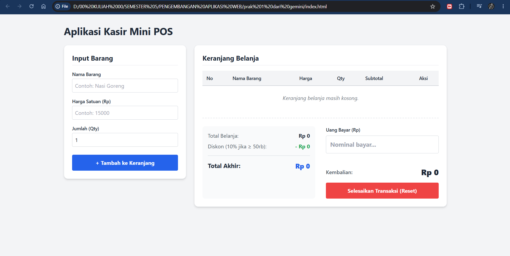
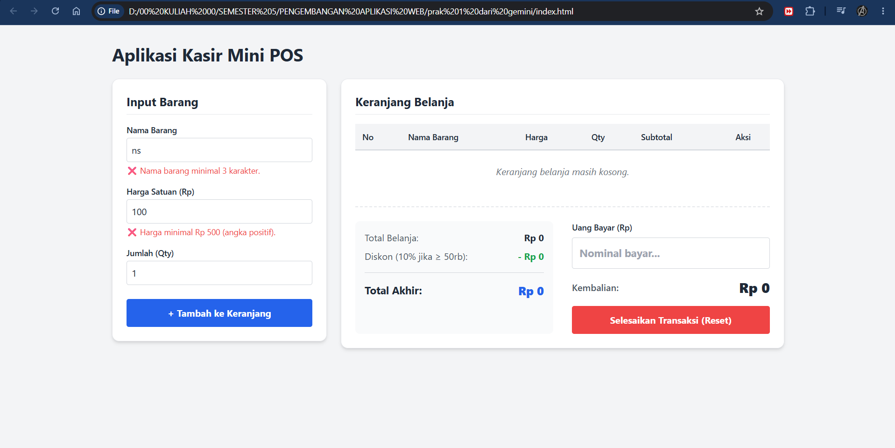
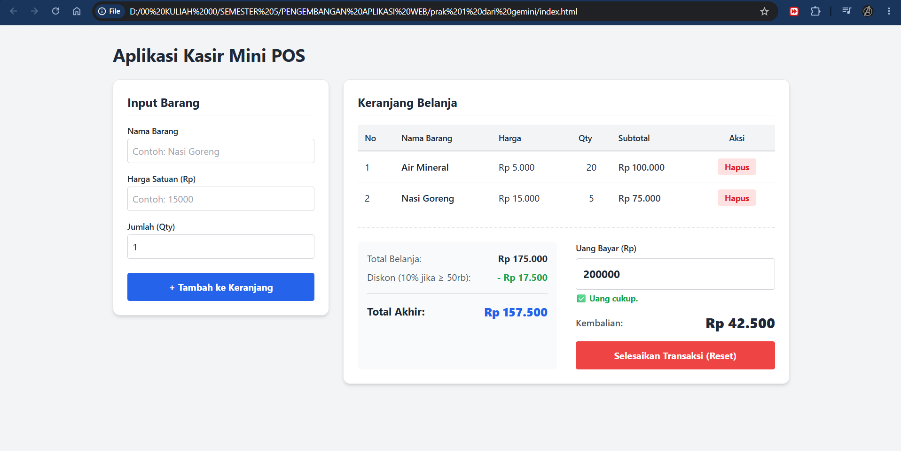

# Aplikasi Kasir & Keranjang Belanja Sederhana (Mini POS)

Aplikasi web Kasir Sederhana yang dibuat menggunakan HTML, CSS (Tailwind), dan Vanilla JavaScript untuk mensimulasikan sistem POS (Point of Sale) di kantin kampus.

## 👨‍💻 Identitas
- Nama Lengkap: Aliefiandra Akbar Syahputra
- NIM: 124140076
- Kelas Praktikum: Pengembangan Aplikasi Web (RA) 

## 📌 Deskripsi Aplikasi
Mini POS ini adalah aplikasi kasir berbasis web yang merangkap sebagai kalkulator belanja dan manajemen keranjang. Tujuan pembuatannya adalah sebagai studi kasus penerapan fundamental JavaScript (DOM Manipulation, Array/Object processing, dan Web Storage API) pada sistem transaksi sederhana untuk UMKM, kantin, atau toko kampus.

## ✅ Daftar Fitur (Checklist)
- [x] Validasi Form Input: Mencegah form kosong, membatasi minimal nama 3 karakter, harga > Rp 500, dan kuantitas minimal 1. Memunculkan error feedback berwarna merah.
- [x] Kalkulator Subtotal & Total: Otomatis mengalikan (Harga x Qty) di setiap baris keranjang dan menjumlahkan seluruhnya.
- [x] Kalkulator Diskon Otomatis: Memberikan diskon 10% jika total belanja mencapai Rp 50.000 atau lebih.
- [x] Kalkulator Kembalian Pembayaran: Real-time menghitung uang kembalian dan menampilkan status kecukupan uang kasir.
- [x] Manajemen Keranjang (Hapus & Reset): Menghapus barang satuan per baris atau mengosongkan seluruh keranjang jika transaksi selesai.
- [x] Penyimpanan Persisten (LocalStorage): Data keranjang belanja disimpan di `localStorage` (diserialisasi via JSON) agar tidak hilang ketika browser direfresh.

## 📸 Tangkapan Layar (Screenshot)
(Silakan ganti/masukkan file gambar yang sesuai ke dalam repository GitHub sebelum disubmit)

1. Tampilan Utama & Form Input
   

2. Tampilan Peringatan Error (Validasi Input)
   

3. Tampilan Kalkulator Keranjang & LocalStorage Berfungsi
   

## ⚙️ Penjelasan Teknis Singkat
1. Validasi Input: Proses validasi diletakkan pada Event Listener tombol "Tambah ke Keranjang". JS akan memeriksa nilai `length` string dan memparsing tipe data ke `Float/Int` untuk memverifikasi limit angka. Apabila tidak valid, manipulasi DOM (mengubah class `hidden`) akan memicu error feedback muncul.
2. Algoritma Kalkulator Keuangan: Berjalan pada fungsi `renderCart()`. Menggunakan skema perulangan (loop) pada Array object keranjang. Terdapat percabangan kondisional (`if`) untuk memeriksa apakah nilai total belanja `>= 50000` guna menentukan pemotongan variabel diskon. Fungsi format Rupiah memanfaatkan `Intl.NumberFormat()`.
3. Mekanisme Serialisasi LocalStorage: Saat mengambil data awal, aplikasi menggunakan `JSON.parse(localStorage.getItem('cartData'))`. Apabila ada perubahan di keranjang (tambah/hapus), data array diubah ke bentuk string JSON melalui `JSON.stringify(cart)` untuk disimpan kembali ke dalam disk browser menggunakan metode `setItem()`.