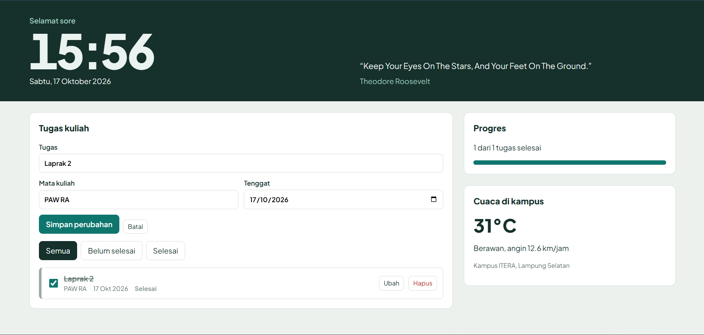

# Deadline Radar - Personal Dashboard Mahasiswa

Dashboard pribadi untuk mahasiswa yang mengurutkan tugas kuliah berdasarkan **kedekatan tenggat**. Setiap tugas diberi garis warna (merah = terlambat, oranye = 2 hari lagi atau kurang, hijau = aman, abu-abu = tanpa tenggat), jadi tugas yang paling mendesak langsung terlihat.

Tugas Praktikum PAW, Pertemuan 2: JavaScript Next Gen (ES6+).

## Identitas

| | |
| --- | --- |
| Nama Lengkap | Aliefiandra Akbar Syahputra |
| NIM | 124140076 |
| Kelas Praktikum | RA |

## Fitur Aplikasi

- **Tugas kuliah (CRUD):** tambah, ubah, hapus, dan tandai selesai. Setiap tugas punya judul, mata kuliah, dan tenggat.
- **Pengurutan otomatis:** tugas belum selesai tampil lebih dulu, diurutkan dari tenggat terdekat.
- **Filter:** Semua, Belum selesai, Selesai.
- **Progres:** bar dan teks jumlah tugas yang sudah selesai.
- **Cuaca kampus ITERA:** data real-time dari Open-Meteo.
- **Kutipan harian:** kutipan acak dari DummyJSON di header.
- **Jam, tanggal, dan sapaan** yang diperbarui otomatis.
- **Penyimpanan lokal:** semua tugas tersimpan di `localStorage` (kunci `deadline-radar:tasks`) dan tetap ada setelah halaman ditutup.

## Screenshot

## Cara Menjalankan

Buka `index.html` di browser (atau gunakan ekstensi Live Server di VS Code). Koneksi internet dibutuhkan untuk cuaca, kutipan, dan font. Jika API gagal, aplikasi tetap berjalan dengan pesan cadangan.

## Struktur File

| File | Isi |
| --- | --- |
| `index.html` | Kerangka halaman |
| `style.css` | Tampilan dan responsivitas |
| `script.js` | Seluruh logika aplikasi |

## Fitur ES6+ yang Diimplementasikan (`script.js`)

| Fitur | Baris | Keterangan |
| --- | --- | --- |
| `const` | 7-9 | Konstanta URL API dan `MS_PER_DAY`. Hampir semua variabel memakai `const` karena nilainya tidak diubah |
| `let` | 237 | `sapaan` diberi nilai awal lalu diganti sesuai jam |
| Arrow function | 12, 14, 17, 232, 195 | `escapeHtml`, `formatDate`, `describeWeather`, `tick`, dan `taskTemplate`. Arrow function juga dipakai sebagai callback `map`, `filter`, `find`, dan event listener |
| Template literals | 198, 254, 225 | Render kartu tugas, widget cuaca, dan teks progres |
| Async/Await | 248, 263 | `loadWeather()` dan `loadQuote()` memanggil `fetch()` dengan `try/catch` |
| Classes | 27, 64 | `TaskItem` memodelkan satu tugas (dengan getter `daysLeft`, `urgency`, `statusLabel`). `DashboardApp` mengelola state, `localStorage`, dan `fetch()` |
| Static class field | 65 | `DashboardApp.STORAGE_KEY` |
| Destructuring | 150, 196, 253 | Destructuring parameter, objek, dan objek bersarang dari respons API |
| Spread operator | 109, 114 | Menambah dan memperbarui array `tasks` tanpa mengubah array lama (immutable) |
| Default parameter | 28 | Nilai default pada constructor `TaskItem` |
| Nullish coalescing `??` | 95 | Nilai cadangan saat membaca `localStorage` |
| Numeric separator | 9 | `86_400_000` |
| localStorage | 95, 103 | `getItem` saat memuat, `setItem` setiap ada perubahan data |
