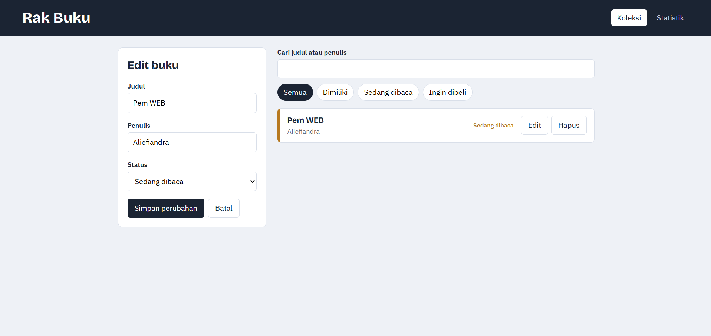
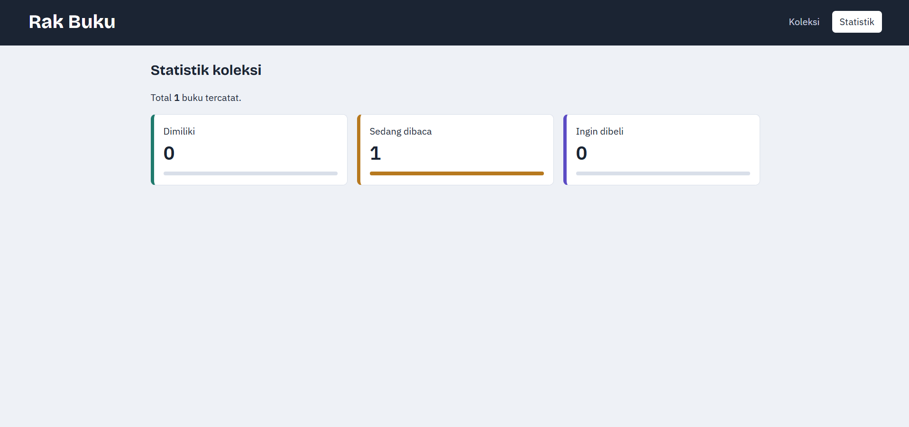
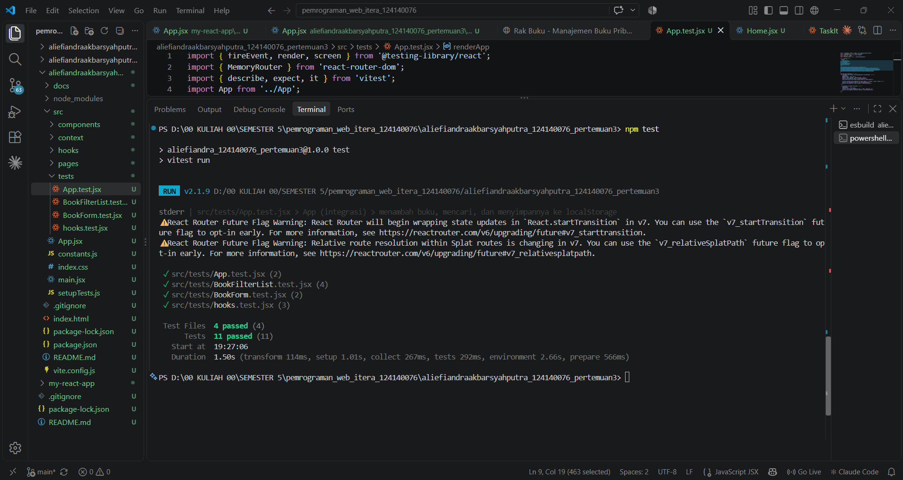

# Rak Buku - Aplikasi Manajemen Buku Pribadi

Tugas Praktikum PAW Pertemuan 3 (React Basics)
Nama: Aliefiandra Akbar Syahputra | NIM: 124140076

## Deskripsi
Aplikasi untuk mencatat buku yang **dimiliki**, **sedang dibaca**, atau **ingin dibeli**. Data tersimpan di `localStorage`, jadi tetap ada setelah halaman dimuat ulang.

## Fitur
- Tambah, edit, dan hapus buku (hapus memakai konfirmasi)
- Filter berdasarkan status dan pencarian judul/penulis
- Validasi form: kolom wajib diisi dengan umpan balik visual (border merah + pesan error)
- Halaman statistik koleksi

## Cara Menjalankan (VS Code)
Prasyarat: [Node.js](https://nodejs.org) 18 atau lebih baru.

1. Buka folder ini di VS Code (`File > Open Folder...`), lalu buka terminal (`Ctrl + ` `).
2. Pasang dependensi:
   ```bash
   npm install
   ```
3. Jalankan aplikasi:
   ```bash
   npm run dev
   ```
4. Buka alamat yang muncul di terminal (biasanya http://localhost:5173).

Menjalankan unit test:
```bash
npm test
```

## Penjelasan Fitur React yang Digunakan
| Fitur | Lokasi | Kegunaan |
| ----- | ------ | -------- |
| `useState` | `BookContext`, `BookForm`, `Home`, `BookList` | Menyimpan daftar buku, filter, pencarian, nilai form, dan mode edit |
| `useEffect` | `useLocalStorage`, `BookForm` | Menyimpan ke localStorage dan menyinkronkan form saat edit |
| `useMemo` / `useCallback` | `BookContext`, `useBookStats` | Menghitung hasil filter/statistik dan menjaga fungsi tetap stabil |
| Context API | `context/BookContext.jsx` | State global buku dibagikan ke semua halaman tanpa prop drilling |
| React Router | `App.jsx` | Navigasi multi-halaman: `/` (Koleksi) dan `/stats` (Statistik) |
| Custom hooks | `hooks/useLocalStorage.js`, `hooks/useBookStats.js` | Logika penyimpanan dan statistik yang dapat dipakai ulang |
| Komponen reusable | `BookForm`, `BookList`, `BookFilter` | Potongan UI terpisah dengan props |
| PropTypes | Semua komponen | Type checking props |

## Struktur Folder
```
src/
├── components/ (BookForm, BookList, BookFilter)
├── pages/      (Home, Stats)
├── hooks/      (useLocalStorage.js, useBookStats.js)
├── context/    (BookContext.jsx)
├── tests/      (unit & integration test)
└── App.jsx
```

## Screenshot Aplikasi

| Halaman Koleksi | Halaman Statistik |
| --------------- | ----------------- |
|  |  |

## Laporan Testing
11 test di `src/tests/` (hooks, form, filter, list, integrasi App). Jalankan `npm test`, lalu simpan screenshot hasilnya:


