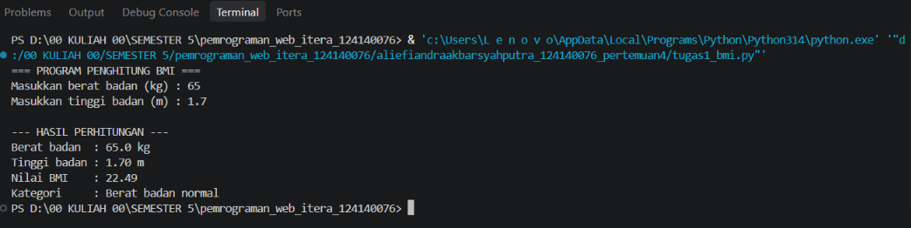
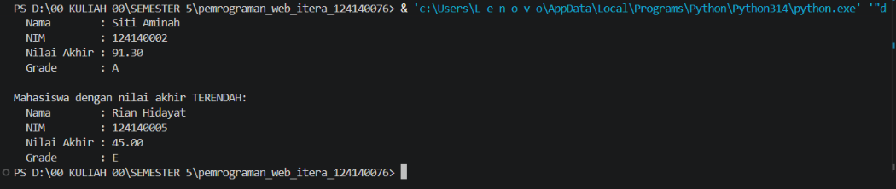
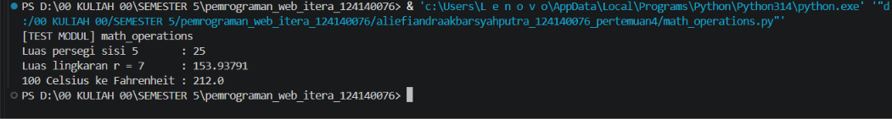

# Tugas Praktikum Pertemuan 4: Dasar Pemrograman Python

Mata kuliah: Pengembangan Aplikasi Web (PAW), Teknik Informatika ITERA

## Identitas Mahasiswa

| Keterangan | Isi                              |
|------------|----------------------------------|
| Nama       | Aliefiandra Akbar Syahputra      |
| NIM        | 124140076                        |

## Struktur Folder

```
aliefiandraakbarsyahputra_124140076_pertemuan4/
├── .gitignore
├── README.md
├── screenshots/
│   ├── soal1_bmi.png
│   ├── soal2_nilai_mahasiswa.png
│   └── soal3_main.png
├── tugas1_bmi.py
├── tugas2_nilai_mahasiswa.py
├── math_operations.py
└── main.py
```

## Cara Menjalankan

Pastikan Python 3.8 ke atas sudah terpasang (`python --version`). Buka
terminal di VS Code pada folder ini, lalu jalankan:

```bash
python tugas1_bmi.py
python tugas2_nilai_mahasiswa.py
python main.py
```

Catatan: gunakan `python3` sebagai pengganti `python` pada macOS / Linux.
`math_operations.py` adalah modul sehingga tidak dijalankan langsung,
melainkan dipanggil oleh `main.py`.

## Deskripsi Program

### Soal 1: Penghitung BMI (`tugas1_bmi.py`)

Program meminta berat badan (kg) dan tinggi badan (m) lewat `input()`,
lalu menghitung BMI dengan rumus `berat / (tinggi * tinggi)` dan
menampilkan hasilnya dengan 2 angka desimal beserta kategorinya.

Alur kerja:

1. `minta_angka()` meminta input dan mengulang sampai nilainya valid
   (harus angka dan berada dalam rentang wajar).
2. `hitung_bmi()` menghitung nilai BMI.
3. `kategori_bmi()` menentukan kategori dengan `if-elif-else`:
   - BMI < 18.5: Berat badan kurang
   - 18.5 <= BMI < 25: Berat badan normal
   - 25 <= BMI < 30: Berat badan berlebih
   - BMI >= 30: Obesitas
4. `main()` mencetak hasil ke terminal.

Contoh output (input: 65 kg dan 1.70 m):

```
=== PROGRAM PENGHITUNG BMI ===
Masukkan berat badan (kg) : 65
Masukkan tinggi badan (m) : 1.70

--- HASIL PERHITUNGAN ---
Berat badan  : 65.0 kg
Tinggi badan : 1.70 m
Nilai BMI    : 22.49
Kategori     : Berat badan normal
```

### Soal 2: Pengelolaan Data Nilai Mahasiswa (`tugas2_nilai_mahasiswa.py`)

Program menyimpan 7 data mahasiswa dalam sebuah list berisi dictionary
(kunci: `nama`, `nim`, `nilai_uts`, `nilai_uas`, `nilai_tugas`).

Alur kerja:

1. `hitung_nilai_akhir()` menghitung
   `30% * UTS + 40% * UAS + 30% * Tugas`.
2. `tentukan_grade()` menentukan grade A (>= 80), B (70-79), C (60-69),
   D (50-59), atau E (< 50).
3. `proses_data()` menambahkan `nilai_akhir` dan `grade` ke setiap data.
4. `cetak_tabel()` menampilkan seluruh data dalam tabel rapi memakai
   perataan f-string.
5. `cari_tertinggi_terendah()` mencari mahasiswa dengan nilai akhir
   tertinggi dan terendah memakai `max()` dan `min()`.

Contoh output:

```
DAFTAR NILAI MAHASISWA
==============================================================================
No  Nama                NIM            UTS   UAS   Tugas   Nilai Akhir   Grade
==============================================================================
1   Budi Santoso        124140001       78    85      90         84.40       A
2   Siti Aminah         124140002       92    88      95         91.30       A
3   Andi Pratama        124140003       65    70      72         69.10       C
4   Dewi Lestari        124140004       55    60      58         57.90       D
5   Rian Hidayat        124140005       40    45      50         45.00       E
6   Eko Prasetyo        124140006       82    75      80         78.60       B
7   Maya Putri          124140007       70    68      74         70.40       B
==============================================================================

Mahasiswa dengan nilai akhir TERTINGGI:
  Nama        : Siti Aminah
  NIM         : 124140002
  Nilai Akhir : 91.30
  Grade       : A

Mahasiswa dengan nilai akhir TERENDAH:
  Nama        : Rian Hidayat
  NIM         : 124140005
  Nilai Akhir : 45.00
  Grade       : E
```

### Soal 3: Modul Matematika (`math_operations.py` dan `main.py`)

`math_operations.py` adalah modul yang berisi:

- Konstanta `PI = 3.14159`
- Geometri: `luas_persegi`, `keliling_persegi`, `luas_persegi_panjang`,
  `keliling_persegi_panjang`, `luas_lingkaran`, `keliling_lingkaran`
- Konversi suhu: `celsius_ke_fahrenheit`, `celsius_ke_kelvin`

`main.py` mengimpor modul tersebut dengan dua cara berbeda:

- `import math_operations`: dipakai untuk fungsi persegi dan persegi
  panjang (dipanggil dengan awalan `math_operations.`).
- `from math_operations import PI, luas_lingkaran, ...`: dipakai untuk
  fungsi lingkaran dan konversi suhu (dipanggil langsung tanpa awalan).

Seluruh fungsi diuji dengan beberapa nilai masukan dan hasilnya dicetak
dalam format terstruktur. Contoh sebagian output:

```
============================================================
                  LINGKARAN (PI = 3.14159)
============================================================
r     3 | Luas:    28.27 | Keliling:   18.85
r     7 | Luas:   153.94 | Keliling:   43.98
r  10.5 | Luas:   346.36 | Keliling:   65.97
```

## Screenshot Hasil Eksekusi

### Soal 1: Penghitung BMI



### Soal 2: Pengelolaan Data Nilai Mahasiswa



### Soal 3: Modul Matematika (main.py)


