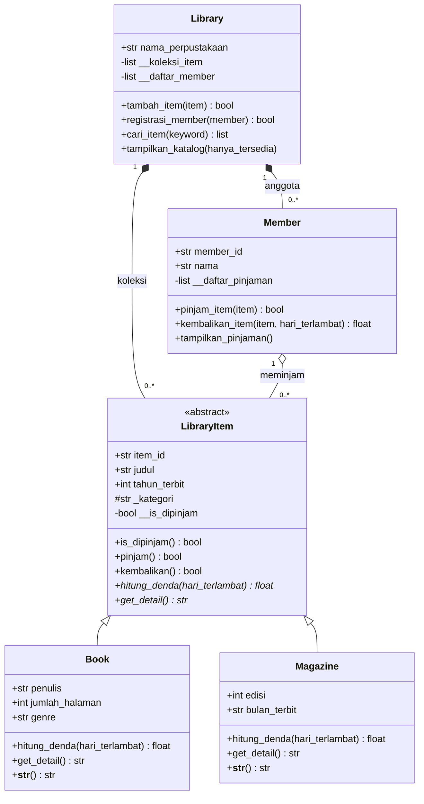
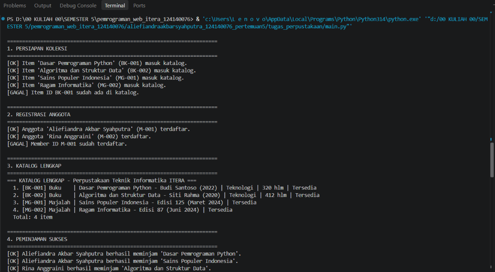

# Praktikum PAW - Pertemuan 5: Python OOP

Tugas: **Sistem Manajemen Perpustakaan Terpadu Berbasis OOP (Library Management System)**.

## Identitas Mahasiswa

| Keterangan | Isi |
|---|---|
| Nama Lengkap | Aliefiandra Akbar Syahputra |
| NIM | 124140076 |
| Kelas Praktikum | _(isi: RA / RB)_ |
| Dosen Pengampu / Asisten Praktikum | _(isi nama dosen / asprak)_ |

## Struktur Folder

```text
aliefiandraakbarsyahputra_124140076_pertemuan5/
├── latihan/
│   ├── 01_everything_is_object.py
│   ├── 01_procedural_vs_oop.py
│   ├── 02_class_object.py
│   ├── 03_inheritance.py
│   ├── 04_encapsulation.py
│   ├── 05_polymorphism.py
│   └── 06_abstract_class.py
├── tugas_perpustakaan/
│   ├── library_item.py   # LibraryItem (abstract), Book, Magazine
│   ├── member.py         # Member
│   ├── library.py        # Library
│   └── main.py           # driver pengujian
├── screenshots/          # bukti tangkapan layar output main.py
├── README.md
└── .gitignore
```

## Deskripsi Arsitektur OOP

| Class | Berkas | Fungsi |
|---|---|---|
| `LibraryItem(ABC)` | `library_item.py` | Abstract class induk semua koleksi. Menyimpan `item_id`, `judul`, `tahun_terbit`, `_kategori` (protected), dan `__is_dipinjam` (private). Menyediakan `pinjam()`, `kembalikan()`, property `is_dipinjam`, serta abstract method `hitung_denda()` dan `get_detail()`. |
| `Book` | `library_item.py` | Turunan `LibraryItem` dengan `penulis`, `jumlah_halaman`, `genre`. Denda **Rp 2.000/hari**. |
| `Magazine` | `library_item.py` | Turunan `LibraryItem` dengan `edisi`, `bulan_terbit`. Denda **Rp 1.000/hari**. |
| `Member` | `member.py` | Anggota perpustakaan. Menyimpan `__daftar_pinjaman` (private); method `pinjam_item()`, `kembalikan_item()`, `tampilkan_pinjaman()`. |
| `Library` | `library.py` | Pusat pengelolaan. Menyimpan `__koleksi_item` dan `__daftar_member` (private); method `tambah_item()`, `registrasi_member()`, `cari_item()`, `tampilkan_katalog()`. |

### Penerapan 4 Pilar OOP

1. **Abstraction** - `LibraryItem` adalah kontrak (`ABC`) dengan dua `@abstractmethod`. Class ini tidak dapat diinstansiasi langsung (menghasilkan `TypeError`).
2. **Inheritance** - `Book` dan `Magazine` mewarisi `LibraryItem` dan memanggil `super().__init__()` untuk mengisi atribut bersama.
3. **Encapsulation** - `__is_dipinjam`, `__daftar_pinjaman`, `__koleksi_item`, dan `__daftar_member` bersifat private (name mangling). Status peminjaman hanya bisa dibaca lewat `@property is_dipinjam` dan diubah lewat `pinjam()` / `kembalikan()`. `_kategori` bersifat protected dan dibaca lewat property `kategori`.
4. **Polymorphism** - `hitung_denda()`, `get_detail()`, dan `__str__()` di-override berbeda pada `Book` dan `Magazine`. `Member.kembalikan_item()` dan `Library.tampilkan_katalog()` memprosesnya tanpa percabangan `if isinstance(...)`.

## Diagram Kelas



Versi teks (ASCII):

```text
            +-------------------+
            | LibraryItem (ABC) |
            +-------------------+
               ^            ^
               |            |
          +--------+   +-----------+
          |  Book  |   | Magazine  |
          +--------+   +-----------+

  Library  <>--- koleksi ---> LibraryItem  (komposisi)
  Library  <>--- anggota ---> Member       (komposisi)
  Member   o---- meminjam --> LibraryItem  (agregasi)
```

## Petunjuk Eksekusi

Prasyarat: **Python 3.10+** (tanpa library tambahan).

```bash
# 1. Masuk ke folder tugas
cd tugas_perpustakaan

# 2. Jalankan program driver
python main.py        # Windows
python3 main.py       # Linux / macOS
```

Latihan modul dapat dijalankan satu per satu, contoh:

```bash
cd latihan
python 03_inheritance.py
```

## Skenario yang Didemonstrasikan di `main.py`

1. Persiapan koleksi (2 `Book` + 2 `Magazine`) dan penolakan ID duplikat
2. Registrasi anggota (2 anggota awal, 1 anggota tambahan di skenario denda)
3. Katalog lengkap
4. Peminjaman sukses
5. Percobaan meminjam item yang sudah dipinjam
6. Katalog hanya item yang tersedia
7. Pencarian item (judul / ID / tidak ditemukan)
8. Detail item dan daftar pinjaman anggota
9. Pengembalian tepat waktu
10. Pengembalian terlambat dengan denda polimorfik (buku Rp 2.000/hari, majalah Rp 1.000/hari)
11. Penanganan error (pengembalian item yang tidak dipinjam, hari negatif, tipe salah, akses atribut private, instansiasi abstract class)
12. Katalog akhir

## Screenshot Output

Tempatkan tangkapan layar terminal saat `python main.py` berhasil dijalankan di folder `screenshots/` lalu tampilkan di sini:

<!--  -->

## Output Program (`python main.py`)

```text
======================================================================
1. PERSIAPAN KOLEKSI
======================================================================
[OK] Item 'Dasar Pemrograman Python' (BK-001) masuk katalog.
[OK] Item 'Algoritma dan Struktur Data' (BK-002) masuk katalog.
[OK] Item 'Sains Populer Indonesia' (MG-001) masuk katalog.
[OK] Item 'Ragam Informatika' (MG-002) masuk katalog.
[GAGAL] Item ID BK-001 sudah ada di katalog.

======================================================================
2. REGISTRASI ANGGOTA
======================================================================
[OK] Anggota 'Aliefiandra Akbar Syahputra' (M-001) terdaftar.
[OK] Anggota 'Rina Anggraini' (M-002) terdaftar.
[GAGAL] Member ID M-001 sudah terdaftar.

======================================================================
3. KATALOG LENGKAP
======================================================================
=== KATALOG LENGKAP - Perpustakaan Teknik Informatika ITERA ===
  1. [BK-001] Buku    | Dasar Pemrograman Python - Budi Santoso (2022) | Teknologi | 320 hlm | Tersedia
  2. [BK-002] Buku    | Algoritma dan Struktur Data - Siti Rahma (2020) | Teknologi | 412 hlm | Tersedia
  3. [MG-001] Majalah | Sains Populer Indonesia - Edisi 125 (Maret 2024) | Tersedia
  4. [MG-002] Majalah | Ragam Informatika - Edisi 87 (Juni 2024) | Tersedia
  Total: 4 item

======================================================================
4. PEMINJAMAN SUKSES
======================================================================
[OK] Aliefiandra Akbar Syahputra berhasil meminjam 'Dasar Pemrograman Python'.
[OK] Aliefiandra Akbar Syahputra berhasil meminjam 'Sains Populer Indonesia'.
[OK] Rina Anggraini berhasil meminjam 'Algoritma dan Struktur Data'.

======================================================================
5. PERCOBAAN MEMINJAM ITEM YANG SUDAH DIPINJAM
======================================================================
[GAGAL] 'Dasar Pemrograman Python' sedang dipinjam anggota lain.
[GAGAL] Aliefiandra Akbar Syahputra sudah meminjam 'Dasar Pemrograman Python'.

======================================================================
6. KATALOG HANYA YANG TERSEDIA
======================================================================
=== KATALOG TERSEDIA - Perpustakaan Teknik Informatika ITERA ===
  1. [MG-002] Majalah | Ragam Informatika - Edisi 87 (Juni 2024) | Tersedia
  Total: 1 item

======================================================================
7. PENCARIAN ITEM
======================================================================
Pencarian 'python': 1 hasil
  -> [BK-001] Buku    | Dasar Pemrograman Python - Budi Santoso (2022) | Teknologi | 320 hlm | Dipinjam
Pencarian 'MG-00': 2 hasil
  -> [MG-001] Majalah | Sains Populer Indonesia - Edisi 125 (Maret 2024) | Dipinjam
  -> [MG-002] Majalah | Ragam Informatika - Edisi 87 (Juni 2024) | Tersedia
Pencarian 'tidak-ada': 0 hasil

======================================================================
8. DETAIL ITEM (get_detail) & DAFTAR PINJAMAN
======================================================================
[BK-001] Dasar Pemrograman Python
  Kategori : Buku
  Penulis  : Budi Santoso
  Terbit   : 2022
  Halaman  : 320
  Genre    : Teknologi
  Denda    : Rp 2.000/hari
  Status   : Dipinjam

[MG-001] Sains Populer Indonesia
  Kategori : Majalah
  Edisi    : 125
  Terbit   : Maret 2024
  Denda    : Rp 1.000/hari
  Status   : Dipinjam

Daftar pinjaman Aliefiandra Akbar Syahputra (M-001):
  1. [BK-001] Buku    | Dasar Pemrograman Python - Budi Santoso (2022) | Teknologi | 320 hlm | Dipinjam
  2. [MG-001] Majalah | Sains Populer Indonesia - Edisi 125 (Maret 2024) | Dipinjam
Daftar pinjaman Rina Anggraini (M-002):
  1. [BK-002] Buku    | Algoritma dan Struktur Data - Siti Rahma (2020) | Teknologi | 412 hlm | Dipinjam

======================================================================
9. PENGEMBALIAN TEPAT WAKTU
======================================================================
[OK] 'Sains Populer Indonesia' dikembalikan Aliefiandra Akbar Syahputra tepat waktu. Tanpa denda.

======================================================================
10. PENGEMBALIAN TERLAMBAT (DENDA POLIMORFIK)
======================================================================
[OK] 'Dasar Pemrograman Python' dikembalikan Aliefiandra Akbar Syahputra terlambat 5 hari. Denda: Rp 10.000
[OK] 'Algoritma dan Struktur Data' dikembalikan Rina Anggraini terlambat 3 hari. Denda: Rp 6.000
[OK] Anggota 'Dimas Pratama' (M-003) terdaftar.
[OK] Dimas Pratama berhasil meminjam 'Ragam Informatika'.
[OK] 'Ragam Informatika' dikembalikan Dimas Pratama terlambat 5 hari. Denda: Rp 5.000

Denda 7 hari untuk semua item (satu loop, tanpa cek tipe):
  BK-001 (Buku   ): Rp 14.000
  BK-002 (Buku   ): Rp 14.000
  MG-001 (Majalah): Rp 7.000
  MG-002 (Majalah): Rp 7.000

======================================================================
11. PENANGANAN KONDISI ERROR
======================================================================
[GAGAL] Aliefiandra Akbar Syahputra tidak sedang meminjam 'Algoritma dan Struktur Data'.
[OK] Aliefiandra Akbar Syahputra berhasil meminjam 'Algoritma dan Struktur Data'.
[GAGAL] Pengembalian 'Algoritma dan Struktur Data' dibatalkan: hari_terlambat harus berupa bilangan bulat >= 0
[OK] 'Algoritma dan Struktur Data' dikembalikan Aliefiandra Akbar Syahputra tepat waktu. Tanpa denda.
[GAGAL] Objek yang dipinjam bukan item yang valid.

Uji enkapsulasi & abstract class:
  Akses atribut private ditolak (AttributeError): 'Book' object has no attribute '__is_dipinjam'
  Instansiasi abstract class ditolak (TypeError): Can't instantiate abstract class LibraryItem without an implementation for abstract methods 'get_detail', 'hitung_denda'

======================================================================
12. KATALOG AKHIR
======================================================================
=== KATALOG LENGKAP - Perpustakaan Teknik Informatika ITERA ===
  1. [BK-001] Buku    | Dasar Pemrograman Python - Budi Santoso (2022) | Teknologi | 320 hlm | Tersedia
  2. [BK-002] Buku    | Algoritma dan Struktur Data - Siti Rahma (2020) | Teknologi | 412 hlm | Tersedia
  3. [MG-001] Majalah | Sains Populer Indonesia - Edisi 125 (Maret 2024) | Tersedia
  4. [MG-002] Majalah | Ragam Informatika - Edisi 87 (Juni 2024) | Tersedia
  Total: 4 item

Total item: 4 | Total anggota: 3
```
